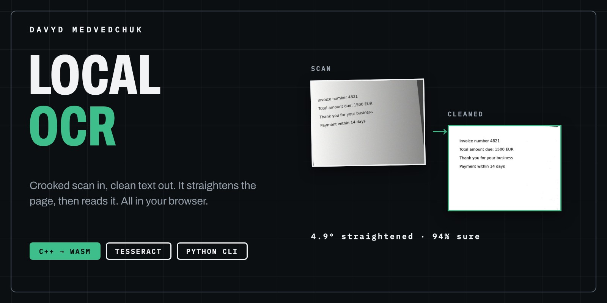

# Local OCR



Read text from scans, photos and PDFs. It straightens the page, cleans it up and runs OCR. Everything happens on your device, so nothing is uploaded.

**[Open the app](https://davydmedvedchuk.github.io/local-ocr/)**

Drop JPG, PNG, WebP or PDF files, pick the language, press "Read text". You get the text per page, with Copy and Save .txt. Tap a preview to compare the original with the cleaned page.

## Why the clean-up matters

A crooked, shadowed phone photo is where plain Tesseract fails. The test scan below is turned 5° and has a shadow on one side. Plain Tesseract read it as `a UU … ce number 4821`. After the clean-up it reads all four lines correctly.

The clean-up is written in C++ (`src/prep.cpp`) and compiled to WebAssembly (`prep.wasm`, 4.5 KB):

1. **Black and white with an adaptive threshold** (Bradley, integral image). Shadows and uneven light stop mattering.
2. **Deskew by projection profile.** For angles from −15° to 15° it counts dark pixels per row. When the lines are level, the counts peak. 0.5° steps first, then 0.1°.
3. **Rotate** the gray page (bilinear), threshold again, paint a thin frame white so scanner edges do not become characters.

No Emscripten and no libc: plain `clang --target=wasm32`, a tiny bump allocator and a few exported functions. `./build.sh` rebuilds it.

Then [Tesseract.js](https://github.com/naptha/tesseract.js) 7 reads the page. Languages: English, Portuguese, Russian, Ukrainian.

## Command line (Python)

The same clean-up written in numpy, then the Tesseract program.

```
pip install -r cli/requirements.txt          # also install tesseract and the language packs
python3 cli/ocr.py scan.jpg -l eng+por
python3 cli/ocr.py a.png b.png -l rus -o text.txt
python3 cli/ocr.py scan.jpg --save-clean cleaned.png
```

## Limits

- It reads printed text. Handwriting and very blurry photos come out poorly.
- Pages above 3000 px on the long side are scaled down first, for speed and memory.
- Two-column layouts are read in Tesseract's own order; no layout analysis of mine.
- HEIC is not accepted here. Use [Photo shrinker](https://davydmedvedchuk.github.io/photo-shrinker/) to convert, or [PDF toolkit](https://davydmedvedchuk.github.io/pdf-toolkit/), which also makes searchable PDFs.
- The first run downloads language files (7 to 14 MB each) from this site and caches them.

## Layout

```
index.html        the app (one file)
prep.wasm         compiled from src/prep.cpp
src/prep.cpp      deskew, threshold, rotate
build.sh          rebuild prep.wasm
cli/ocr.py        Python command line
vendor/           tesseract.js, core, language data, pdf.js, fonts (nothing is loaded from other sites)
```

## Credits

Made by Davyd Medvedchuk. Tesseract.js and tesseract.js-core (Apache-2.0), pdf.js (Apache-2.0), Tesseract trained data (Apache-2.0). Fonts: Archivo and IBM Plex Mono (SIL OFL 1.1). Licences are in `vendor/`.

MIT licence.
